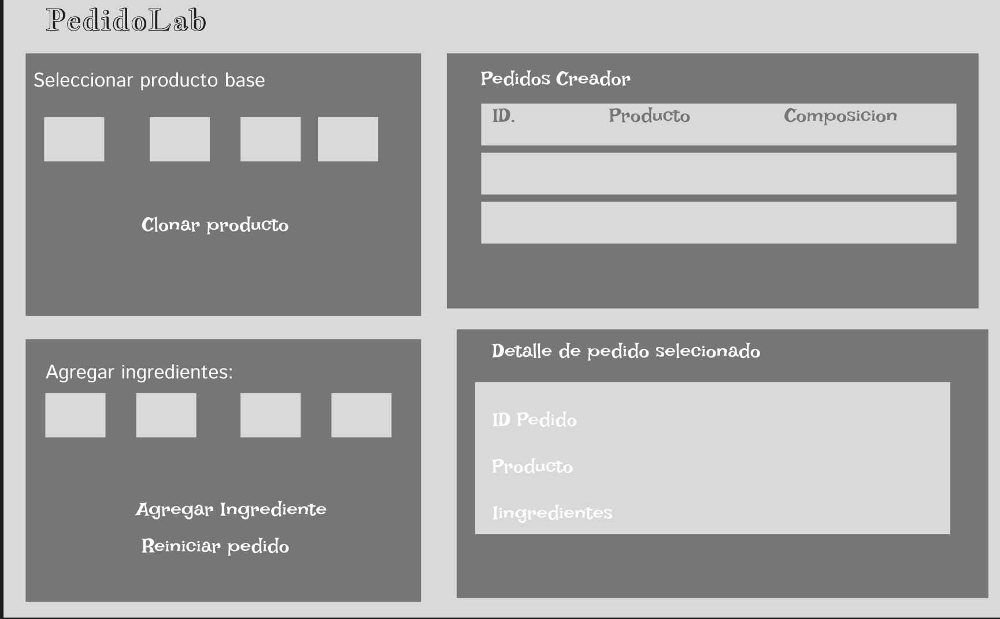

## Practica de programacion aplicada
## Nombre: Bryam Collaguazo
## Backup
## Mi Diseño

## Diseño de stitch


## Estructura Final de las clase (MVC)

### Estructura de clases usando MVC (Modelo, Vista y Controlador)

```java
app/src/main/java/edu/ups/pap/
├── App.java
├── modelo/
│   ├── Pedido.java
│   ├── TipoProducto.java
│   ├── prototype/
│   │   ├── Prototipo.java
│   │   ├── ProductoBase.java
│   │   ├── Cafe.java
│   │   ├── Ensalada.java
│   │   ├── Pizza.java
│   │   └── RegistroPrototipos.java
│   ├── decorator/
│   │   ├── DecoradorIngrediente.java
│   │   ├── Azucar.java
│   │   ├── Crema.java
│   │   ├── Tomate.java
│   │   ├── Pollo.java
│   │   ├── Queso.java
│   │   └── Pepperoni.java
│   └── servicio/
│       └── ServicioPedidos.java
├── vista/
│   └── VentanaPedidos.java
└── controlador/
    └── ControladorPedidos.java
```


